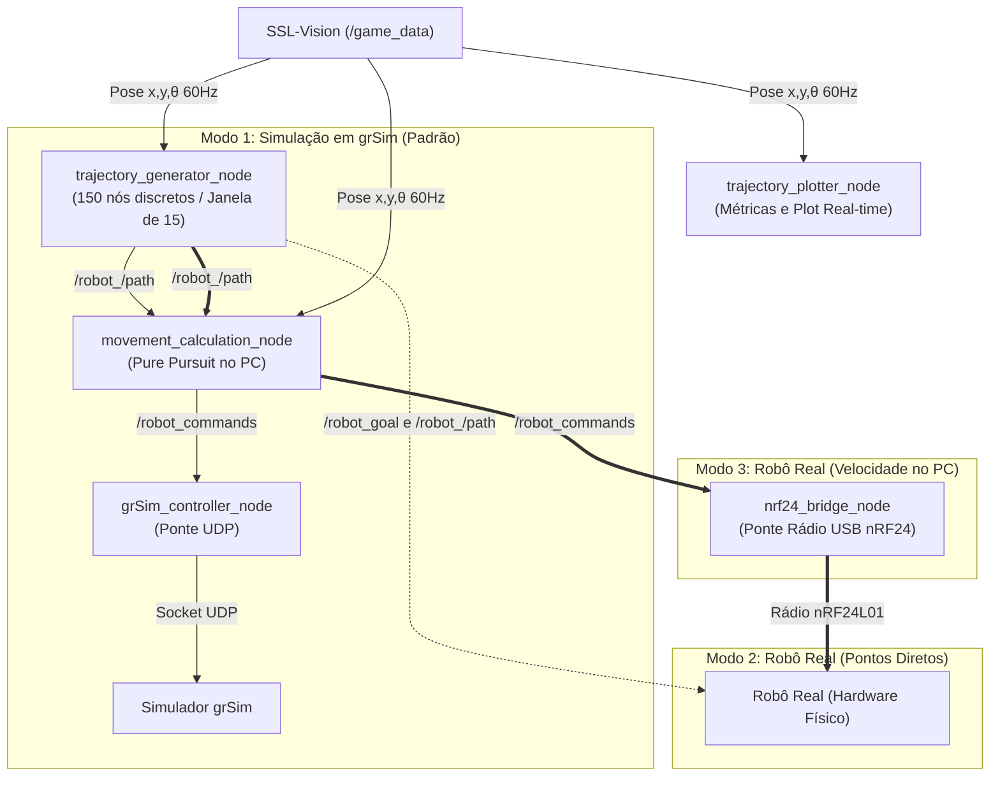

# oxebots_trajectory_analysis

Módulo para geração de trajetórias analíticas de teste e visualização/análise de perseguição de rota em tempo real usando Matplotlib e ROS 2 no campo da **SSL Entry Division (4500 mm x 3000 mm)**.

Totalmente compatível com **grSim (simulação)**, **robô real** e **reprodução de rosbags**.

> [!NOTE]
> **Padrão em Milímetros (mm) e Visualização Focada:**
> * O plot exibe **exclusivamente a figura geométrica sob teste** (círculo, quadrado ou onda) com uma folga configurável (`margin_mm`, padrão: 250 mm).
> * Todas as coordenadas, eixos e métricas de erro são calculados e exibidos em **milímetros (mm)**.
> * A trajetória do robô **nunca é apagada** durante a execução, preservando o histórico completo para uso em artigos científicos.
> * Ao encerrar o teste (fechar a janela ou Ctrl+C), um **relatório estatístico completo de erros** é impresso diretamente no terminal e as figuras em 300 DPI são salvas automaticamente na pasta `src/oxebots_trajectory_analysis/imagens/`.

---

## Discretização Espacial e Temporal

O módulo adota uma abordagem discretizada tanto no planejamento quanto na captura dos dados:

1. **Rota Desejada Discretizada (150 nós) e Janela Deslizante:**
   * A curva geométrica de referência é dividida em **150 waypoints discretos e sequenciais**.
   * Em um círculo de raio $R = 800\text{ mm}$ (perímetro de $\approx 5.026\text{ mm}$), cada nó dista **$\approx 33.5\text{ mm}$ ($3.3\text{ cm}$)** do nó vizinho, oferecendo resolução precisa e leve para o controle.
   * **Janela Deslizante (`path_window_size`):** O nó gerador não publica todos os nós de uma vez só no caminho de controle; ele envia apenas uma janela dos **próximos 15 nós à frente** do robô ($\approx 500\text{ mm}$ de horizonte), evitando sobrecarga de tópicos e prevenindo que o robô confunda pontos da volta anterior.
   * A rota completa de 150 nós continua sendo publicada em `/robot_<id>/path_viz` para visualização gráfica no Matplotlib e RViz.
2. **Amostragem Temporal do Robô (60 Hz e Marcadores a 10 Hz):**
   * A posição real do robô é recebida via SSL-Vision (`/game_data`) a **60 Hz** (60 amostras por segundo).
   * Para evidenciar a discretização temporal no gráfico sem poluir visualmente, o rastro amarelo exibe marcadores pontuais circulares a cada 6 amostras ($\approx 10\text{ Hz}$ / 100 ms).
3. **Alvo Atual de Perseguição (Target Goal):**
   * Representado no plot por uma **estrela vermelha** e uma linha pontilhada de perseguição (*lookahead vector*).
   * O alvo avança estritamente passo a passo ao longo dos nós da rota, sem saltos nem inversões de sentido.

---

## Geometria e Dimensões dos Padrões

O campo oficial da **Entry Division** possui dimensões de **4.5m de comprimento por 3.0m de largura**. O centro do campo é a origem das coordenadas: **$(x=0.0, y=0.0)$**.

### 1. Círculo (`circle`)
* **Centro:** $(x = 0.0\,\text{m},\, y = 0.0\,\text{m})$ — centro do campo.
* **Raio ($R$):** **$0.80\,\text{m}$** (diâmetro de $1.60\,\text{m}$).
* **Ponto Inicial:** **$(x = +0.80\,\text{m},\, y = 0.0\,\text{m})$**
* **Sentido:** **Anti-horário** (sai de $(+0.8, 0.0)$ e sobe em direção ao norte $(0.0, +0.8)$).
* **Compensação de Curvatura:** Possui termo feedforward geométrico ($\Delta r \approx L^2 / 2R$) e feedback proporcional radial para cancelar o corte de corda inerente ao *Pure Pursuit*.

### 2. Quadrado (`square`)
* **Centro:** $(x = 0.0\,\text{m},\, y = 0.0\,\text{m})$
* **Tamanho do Lado:** **$1.40\,\text{m}$** ($\pm 0.70\,\text{m}$ do centro).
* **Ponto Inicial:** **$(-0.70\,\text{m},\, -0.70\,\text{m})$** (canto inferior esquerdo).
* **Sequência dos Vértices:** Sentido anti-horário percorrendo os 4 vértices sequencialmente.

### 3. Onda Quadrada (`square_wave`)
* **Centro:** $(x = 0.0\,\text{m},\, y = 0.0\,\text{m})$
* **Amplitude ($A$):** **$0.50\,\text{m}$** (degrau pico-a-pico de $1.0\,\text{m}$, variando entre $Y = -0.50\,\text{m}$ e $Y = +0.50\,\text{m}$).
* **Comprimento de cada degrau em X:** **$0.60\,\text{m}$**.
* **Ponto Inicial:** **$(-1.20\,\text{m},\, -0.50\,\text{m})$**
* **Propósito:** Medir a resposta ao degrau (*step response*), o sobressinal (*overshoot*) e o tempo de estabilização do robô após curvas de 90°.

---

## Arquitetura de Comunicação e Tópicos

| Tópico | Tipo de Mensagem | Publicador | Consumidor | Descrição |
| :--- | :--- | :--- | :--- | :--- |
| `/robot_<id>/path` | `nav_msgs/msg/Path` | Gerador | `movement_calculation_node` / Firmware | Janela deslizante de nós ativos à frente do robô (padrão: 15 nós). |
| `/robot_<id>/path_viz` | `nav_msgs/msg/Path` | Gerador | `trajectory_plotter_node` | Rota estática ideal completa com 150 nós em mm. |
| `/robot_<id>/target_goal` | `RobotGoal` | Gerador | `trajectory_plotter_node` | Alvo visual de perseguição (estrela vermelha). |
| `/robot_goal` | `RobotGoal` | Gerador | Robô Real / Firmware | Alvo com coordenadas imediatas do waypoint. |
| `/game_data` | `oxebots_interfaces/msg/GameData` | `game_observer_node` | Plotter e Seguidor | Posições reais dos robôs (em milímetros). |
| `/robot_commands` | `oxebots_interfaces/msg/RobotCmd` | `movement_calculation_node` | `grSim_controller_node` / `nrf24_bridge_node` | Comandos de velocidade linear e angular ($v_x, v_y, \omega$). |

> [!IMPORTANT]
> **Isolamento entre Modo Analítico e Estratégia de Partida:**
> No modo analítico, o alvo visual é publicado em `/robot_<id>/target_goal`. Isso impede que o nó de movimento execute a frenagem de aproximação de chute (ativada quando `/robot_goal` está a $<100\text{ mm}$), garantindo que robôs omnidirecionais transitem com suavidade contínua, sem travar nem oscilar em rotação.

---

## Modos de Operação do Benchmark (3 Modos)

O benchmark suporta **3 fluxos operacionais completos**, configuráveis diretamente pelas flags `target` e `use_movement_calculation`:



### 1. Modo 1: Simulação em grSim (`target:=sim`, padrão)
* **Pipeline:** `trajectory_generator_node` $\rightarrow$ `movement_calculation_node` $\rightarrow$ `/robot_commands` $\rightarrow$ `grSim_controller_node` $\rightarrow$ **grSim (UDP)**.
* **Descrição:** Modo padrão para desenvolvimento e validação analítica rápida. O gerador calcula a janela de nós da rota; o `movement_calculation_node` executa o *Pure Pursuit* no PC calculando $v_x, v_y, \omega$; o `grSim_controller_node` empacota e envia os comandos via socket UDP para os robôs virtuais do grSim. A visão SSL-Vision lê a posição simulada e fecha a malha.
* **Comando ROS 2:**
  ```bash
  ros2 launch oxebots_trajectory_analysis trajectory_benchmark.launch.py \
      standalone:=true \
      target:=sim \
      pattern:=circle
  ```

### 2. Modo 2: Robô Real com Pontos Diretos (`target:=real use_movement_calculation:=false`)
* **Pipeline:** `trajectory_generator_node` $\rightarrow$ `/robot_goal` e `/robot_<id>/path` $\rightarrow$ **Robô Real (Firmware Onboard)**.
* **Descrição:** Modo projetado para testar algoritmos de perseguição de trajetória ou navegação implementados **diretamente no microcontrolador** (STM32/ESP32) do robô real. O nó `movement_calculation_node` do PC é completamente contornado (*bypass*). O gerador envia as coordenadas espaciais dos pontos desejados, e o firmware embarcado é quem calcula as velocidades dos motores.
* **Comando ROS 2:**
  ```bash
  ros2 launch oxebots_trajectory_analysis trajectory_benchmark.launch.py \
      standalone:=true \
      target:=real \
      use_movement_calculation:=false \
      pattern:=circle
  ```

### 3. Modo 3: Robô Real com Controle de Velocidades no PC (`target:=real use_movement_calculation:=true`)
* **Pipeline:** `trajectory_generator_node` $\rightarrow$ `movement_calculation_node` $\rightarrow$ `/robot_commands` $\rightarrow$ `nrf24_bridge_node` $\rightarrow$ **Robô Real (Rádio nRF24)**.
* **Descrição:** **Variação direta do Modo 1 adaptada para o robô físico real**. O PC continua sendo o responsável por calcular a perseguição de rota via `movement_calculation_node` (*Pure Pursuit*), gerando as velocidades omnidirecionais em `/robot_commands`. O nó `nrf24_bridge_node` assume o lugar do `grSim_controller_node`, codifica os comandos com protocolo bitproto e os transmite via dongle USB rádio nRF24L01+ diretamente aos robôs físicos. A câmera global SSL-Vision lê a posição real no campo e realimenta o sistema a 60 Hz.
* **Comando ROS 2:**
  ```bash
  ros2 launch oxebots_trajectory_analysis trajectory_benchmark.launch.py \
      standalone:=true \
      target:=real \
      use_movement_calculation:=true \
      pattern:=circle
  ```

---

## Como Usar

### Cenário A: Simulação em grSim (Modo 1)
Não precisa rodar `run_match.sh` nem a partida completa. Este modo sobe sozinho: **Visão (SSL-Vision Bridge) + Observador (/game_data) + Comms do grSim + Seguidor no PC + Gerador + Plotter**:

```bash
# 1. Círculo no grSim
ros2 launch oxebots_trajectory_analysis trajectory_benchmark.launch.py \
    standalone:=true \
    target:=sim \
    robot_id:=0 \
    pattern:=circle

# 2. Quadrado no grSim (robô voltado para o centro)
ros2 launch oxebots_trajectory_analysis trajectory_benchmark.launch.py \
    standalone:=true \
    target:=sim \
    robot_id:=0 \
    pattern:=square

# 3. Onda Quadrada no grSim (ping-pong contínuo ida e volta)
ros2 launch oxebots_trajectory_analysis trajectory_benchmark.launch.py \
    standalone:=true \
    target:=sim \
    robot_id:=0 \
    pattern:=square_wave
```

---

### Cenário B: Robô Real com Velocidades no PC via Rádio nRF24 (Modo 3)
Utiliza a dongle USB nRF24L01 para transmitir comandos de velocidade ($v_x, v_y, \omega$) gerados pelo algoritmo de perseguição no PC diretamente para o robô físico real:

```bash
# 1. Círculo no Robô Real com Pure Pursuit no PC
ros2 launch oxebots_trajectory_analysis trajectory_benchmark.launch.py \
    standalone:=true \
    target:=real \
    use_movement_calculation:=true \
    robot_id:=0 \
    pattern:=circle \
    max_linear_speed:=0.50

# 2. Quadrado no Robô Real
ros2 launch oxebots_trajectory_analysis trajectory_benchmark.launch.py \
    standalone:=true \
    target:=real \
    use_movement_calculation:=true \
    robot_id:=0 \
    pattern:=square \
    max_linear_speed:=0.50
```

---

### Cenário C: Robô Real com Pontos Diretos (Modo 2)
Contorna o nó de movimento do PC (*bypass*), enviando waypoints discretos para teste de algoritmos embarcados no firmware do robô real:

```bash
# Círculo com pontos publicados em /robot_goal e /robot_<id>/path
ros2 launch oxebots_trajectory_analysis trajectory_benchmark.launch.py \
    standalone:=true \
    target:=real \
    use_movement_calculation:=false \
    robot_id:=0 \
    pattern:=circle
```

---

### Cenário D: Ajuste Fino de Velocidade e Lookahead
* A velocidade padrão é de `0.20 m/s` (ou `1.0 m/s` para maior dinamismo).
* O limite físico do robô é de `3.0 m/s`. Você pode testar velocidades maiores passando `max_linear_speed:=2.0`.
* Se desejar ajustar a distância de perseguição (*lookahead*) via launch:

```bash
# Ajuste de lookahead e ganho proporcional:
ros2 launch oxebots_trajectory_analysis trajectory_benchmark.launch.py \
    standalone:=true \
    pattern:=circle \
    lookahead_mm:=100.0 \
    lookahead_steps:=10 \
    max_linear_speed:=2.0
```

---

### Cenário E: Modo Paralelo (Com `run_match.sh` ou Robô Real já rodando)
Se você já estiver executando o `./run_match.sh` (partida) ou o `ssl-new.launch.py mode:=game` (robôs reais) em outro terminal, você roda apenas o gerador e o plot (padrão `standalone:=false`):

```bash
ros2 launch oxebots_trajectory_analysis trajectory_benchmark.launch.py \
    robot_id:=0 \
    pattern:=circle
```

---

## Camadas de Controle do Robô (3 Níveis)

A movimentação e a perseguição de trajetória no sistema operam em **3 níveis complementares**:

```
[ SSL-Vision / Câmeras Globais (60 Hz) ]
                   │
                   ▼  (x, y, θ absoluto)
[ 1. Controle de Posição / Trajetória (Software - movement_calculation.cpp) ]
                   │  Calcula vetor (vx, vy, ω) via Pure Pursuit
                   ▼
[ 2. Controle de Velocidade dos Motores (Firmware - Microcontrolador STM32) ]
                   │  Cinemática omnidirecional + Malha PID fechada com Encoders/IMU
                   ▼
[ 3. Atuadores Mecânicos (4 Motores Brushless sobre Carpete SSL) ]
```

1. **Nível 1 - Controle de Trajetória / Rota (Software - Alto Nível):**
   * Implementado em `movement_calculation.cpp` utilizando algoritmo **Pure Pursuit** e ganho proporcional $P$.
   * Lê a rota discreta desejada e a pose real da visão, calculando a cada ciclo as velocidades globais $(v_x, v_y, \omega)$.
   * Calibração de Lookahead (`45.0 mm` a `100.0 mm`): elimina oscilações espúrias sem cortar o raio das curvas.
   * Orientação Holonômica (`face_center:=true`): calcula a orientação angular desejada para que o robô mantenha a frente apontada para o centro $(cx, cy)$ enquanto translada livremente no plano omnidirecional.
2. **Nível 2 - Controle de Velocidade / Odometria (Firmware - Baixo Nível):**
   * Executado diretamente na placa embarcada (STM32/ESP32) em alta frequência (100 Hz a 1 kHz).
   * Recebe as velocidades globais, decompõe-nas pela matriz cinemática omnidirecional em setpoints para cada roda e executa malhas **PID** com feedback de encoders de quadratura e giroscópio (IMU), garantindo que as rodas atinjam a rotação exigida.
3. **Nível 3 - Malha Externa de Posição Absoluta (SSL-Vision):**
   * As rodas omnidirecionais sofrem constante escorregamento (*slip*) sobre o carpete.
   * O SSL-Vision realimenta a posição absoluta $(x, y, \theta)$ a 60 Hz via `/game_data`, fechando a malha global e corrigindo instantaneamente qualquer desvio acumulado pelo atrito e patinagem.

---

### Argumentos Configuráveis do Launch

| Argumento | Padrão | Descrição |
| :--- | :--- | :--- |
| `standalone` | `false` | Se `true`, sobe nós de infraestrutura (visão, observador, controle e seguidor). |
| `target` | `sim` | Destino: `sim` (grSim) ou `real` (robô físico real via rádio nRF24). |
| `use_movement_calculation` | `auto` | Roteamento do nó de velocidade no PC: `auto` (true para sim, false para real com pontos diretos), `true` (Modos 1 e 3) ou `false` (Modo 2). |
| `robot_id` | `0` | ID do robô sob teste e análise (0 a 15). |
| `pattern` | `circle` | Padrão geométrico: `circle`, `square` ou `square_wave`. |
| `total_points` | `150` | Número total de pontos discretizados na rota geométrica ideal. |
| `path_window_size` | `15` | Janela de pontos ativos enviados ao seguidor à frente da posição atual (~500 mm). |
| `lookahead_mm` | `45.0` | Distância do seguidor de rota em mm (calibrado para velocidade suave e precisão milimétrica). |
| `lookahead_steps` | `2` | Número de passos à frente na rota (~33 mm por passo com 150 nós). |
| `p_gain_linear` | `3.0` | Ganho proporcional linear do controlador do robô. |
| `max_linear_speed` | `0.20` | Velocidade linear máxima padrão em m/s (ajustável até 2.0 ou 3.0 m/s). |
| `max_angular_speed`| `1.5` | Velocidade angular máxima em rad/s (giro suave e controlado). |
| `p_gain_angular` | `2.0` | Ganho proporcional angular do controlador. |
| `face_center` | `true` | Se `true`, mantém a frente do robô sempre apontada para o centro $(cx, cy)$. |
| `run_plotter` | `true` | Se deve abrir a interface gráfica do Matplotlib. |
| `margin_mm` | `250.0` | Margem de folga em mm ao redor da figura geométrica. |
| `record_bag` | `false` | Se `true`, grava automaticamente os tópicos de benchmark em um rosbag. |
| `circle_radius` | `0.8` | Raio do círculo em metros. |
| `square_side` | `1.4` | Comprimento do lado do quadrado em metros. |
| `wave_amplitude`| `0.5` | Amplitude Y da onda quadrada em metros. |
| `wave_step_length`| `0.6` | Comprimento em X de cada degrau da onda em metros. |
| `wave_num_cycles`| `2` | Número de ciclos completos da onda quadrada (extensão de 2.4 m). |

---

### Relatório Final e Salvamento Automático

Ao fechar a janela do Matplotlib ou interromper com `Ctrl + C`:
1. As imagens em resolução para publicação científica (300 DPI) são **salvas automaticamente** na pasta `src/oxebots_trajectory_analysis/imagens/` (ex: `trajetoria_robo_0_20260927_002641.png` e `trajetoria_latest.png`).
2. O terminal imprime o relatório estatístico consolidado:

```text
============================================================
       RELATÓRIO FINAL DE ANÁLISE DE TRAJETÓRIA (mm)       
============================================================
  Robô Analisado        : 0
  Tempo Total Gravado   : 42.10 s
  Amostras Coletadas    : 2526
------------------------------------------------------------
  Erro Médio (MAE)      :       8.42 mm  (  0.84 cm)
  RMSE                  :      10.15 mm  (  1.02 cm)
  Desvio Padrão         :       3.21 mm  (  0.32 cm)
  Erro Máximo           :      16.50 mm  (  1.65 cm)
  Erro Mínimo           :       0.85 mm  (  0.08 cm)
  Erro Final            :       2.10 mm  (  0.21 cm)
  Imagem Salva em       : /software_ws/src/oxebots_trajectory_analysis/imagens/trajetoria_robo_0_20260927_002641.png
============================================================
```
